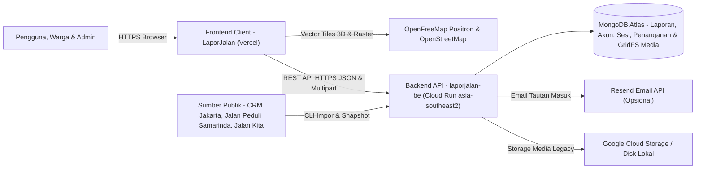

<p align="center">
  <picture>
    <source media="(prefers-color-scheme: dark)" srcset="./public/brand/lockup-horizontal-dark.svg" />
    
  </picture>
</p>

<h1 align="center">LaporJalan - Frontend Client</h1>

<p align="center">
  Platform web partisipatif untuk melihat, melaporkan, dan memantau kondisi kerusakan jalan serta gangguan ruang jalan di Indonesia.
</p>

<p align="center">
  <a href="https://lapor-jalan-two.vercel.app"><strong>Demo Produksi (Vercel)</strong></a>
  -
  <a href="https://laporjalan-be-710000917298.asia-southeast2.run.app/health"><strong>Status Backend API</strong></a>
  -
  <a href="https://github.com/Vereniaes/laporjalan-be"><strong>Repositori Backend</strong></a>
</p>

---

## Daftar Isi

- [Konteks Kompetisi (WIA - MIA 2026)](#konteks-kompetisi-wia---mia-2026)
- [Koneksi Layanan & Arsitektur Sistem](#koneksi-layanan--arsitektur-sistem)
- [Fitur & Rute Aplikasi](#fitur--rute-aplikasi)
- [Tech Stack](#tech-stack)
- [Struktur Direktori](#struktur-direktori)
- [Instalasi & Pengembangan Lokal](#instalasi--pengembangan-lokal)
- [Pengujian & Skrip NPM](#pengujian--skrip-npm)
- [Konfigurasi Deployment (Vercel)](#konfigurasi-deployment-vercel)
- [Progress Saat Ini & Roadmap Pengembangan](#progress-saat-ini--roadmap-pengembangan)
- [Tim Pengembang](#tim-pengembang)
- [Hak Cipta](#hak-cipta)

---

## Konteks Kompetisi (WIA - MIA 2026)

Repositori frontend **LaporJalan** merupakan bagian dari karya tim untuk kompetisi **Web In Action (WIA)** pada rangkaian **Multimedia In Action (MIA) 2026** yang diselenggarakan oleh **KSM Multimedia UPN Veteran Jakarta**.

- **Tema Kompetisi**: *Designing Digital Futures - Powering Public Transparency*
- **Subtema Terpilih**:
  - **Civic Reporting & Accountability** - Pelaporan warga 3 tahap berbasis bukti media dan riwayat penanganan yang dapat dilacak publik.
  - **Open Government Data** - Penyajian snapshot dan data impor laporan infrastruktur jalan dari sumber publik pemerintah.
  - **Public Service Tracking** - Pemantauan progres tindak lanjut laporan dari pelaporan hingga verifikasi pengelola.

---

## Koneksi Layanan & Arsitektur Sistem

Aplikasi frontend ini di-deploy secara terpisah pada **Vercel** ([https://lapor-jalan-two.vercel.app](https://lapor-jalan-two.vercel.app)) dan terhubung langsung ke layanan backend REST API [**laporjalan-be**](https://github.com/Vereniaes/laporjalan-be) di **Google Cloud Run** ([https://laporjalan-be-710000917298.asia-southeast2.run.app](https://laporjalan-be-710000917298.asia-southeast2.run.app)) melalui variabel lingkungan `VITE_API_URL`.

| Komponen | URL / Lokasi | Repositori |
| --- | --- | --- |
| **Frontend Client (Vercel)** | [https://lapor-jalan-two.vercel.app](https://lapor-jalan-two.vercel.app) | [Vereniaes/LaporJalan](https://github.com/Vereniaes/LaporJalan) |
| **Backend REST API (Cloud Run)** | [https://laporjalan-be-710000917298.asia-southeast2.run.app](https://laporjalan-be-710000917298.asia-southeast2.run.app) | [Vereniaes/laporjalan-be](https://github.com/Vereniaes/laporjalan-be) |
| **Konfigurasi Koneksi API** | `VITE_API_URL` ([`.env.example`](./.env.example), [`src/public-reports/data.ts`](./src/public-reports/data.ts)) | - |



Alur data antarlapisan:
1. Klien membaca titik laporan publik melalui `GET /api/public-reports` dan detail/riwayat tindak lanjut melalui `GET /api/public-reports/:id` serta `GET /api/public-reports/:id/handling`.
2. Kesiapan fitur akun dan pelaporan warga diperiksa melalui `GET /api/community/capabilities` berdasarkan header `Origin` halaman aktif.
3. Sesi akun warga maupun admin menggunakan token `Bearer` yang dipelihara melalui `/api/community/auth/*`, `/api/community/reports/*`, dan `/api/community/admin/*`.
4. Peta menggunakan **MapLibre GL JS** dengan gaya `OpenFreeMap Positron` ([`src/public-reports/usePublicInspection.ts`](./src/public-reports/usePublicInspection.ts)) serta kustomisasi warna mode gelap/terang ([`src/map/basemap.ts`](./src/map/basemap.ts)), dan otomatis menyediakan fallback peta raster **Leaflet** (`OpenStreetMap`, [`src/public-reports/LiteMap.tsx`](./src/public-reports/LiteMap.tsx)) untuk perangkat ringan atau tanpa WebGL (`?peta=ringan`).

---

## Fitur & Rute Aplikasi

Rute SPA didefinisikan pada [`src/App.tsx`](./src/App.tsx) dan dukungan URL lama (`/?laporan=...`, `/#masuk=...`) dipertahankan otomatis.

| Rute | Modul | Fungsi Utama |
| --- | --- | --- |
| `/` | [`src/home/HomePage.tsx`](./src/home/HomePage.tsx) | Beranda pengenalan produk dengan peta langsung di hero, maskot Miko ([`MikoMotion.tsx`](./src/home/MikoMotion.tsx)), alur 4 langkah (`Lihat peta`, `Buka laporan`, `Laporkan`, `Pantau pembaruan`), serta FAQ. |
| `/peta` | [`src/public-reports/PublicReportsPage.tsx`](./src/public-reports/PublicReportsPage.tsx) | Peta publik multi-sumber (`Jalan`, `Pembangunan`, `Saluran`, `Pembakaran`), filter kategori & pencarian wilayah, mode terang/gelap, pengalihan `Map3D` WebGL / `LiteMap` `?peta=ringan`, inspeksi objek 3D, serta form laporan warga. |
| `/daftar` (`/regis`) | [`src/account/AuthPage.tsx`](./src/account/AuthPage.tsx) | Registrasi akun warga menggunakan email, nama tampilan opsional, dan kata sandi (`/regis` otomatis diarahkan ke `/daftar`). |
| `/masuk` | [`src/account/AuthPage.tsx`](./src/account/AuthPage.tsx) | Autentikasi email + kata sandi bagi warga dan admin (serta tautan masuk sekali pakai via email bila layanan email aktif). |
| `/akun` | [`src/account/AccountPage.tsx`](./src/account/AccountPage.tsx) | Profil pengguna, daftar `Laporanku`, penambahan pembaruan kondisi laporan, serta pengaturan visibilitas publik laporan pribadi. |
| `/admin` | [`src/admin/AdminPage.tsx`](./src/admin/AdminPage.tsx) | Antrean penanganan laporan gabungan (warga & impor), penugasan unit kerja, pembaruan status penanganan, penandaan duplikat, dan moderasi publikasi khusus akun `admin`. |

### Alur Pelaporan Warga 3 Langkah ([`NewReport.tsx`](./src/public-reports/NewReport.tsx))

1. **Lokasi**: Pemilihan koordinat di wilayah Indonesia lewat pin peta interaktif atau geolokasi perangkat disertai konfirmasi titik dan patokan alamat.
2. **Kondisi**: Unggah bukti foto/video (maks. 3 berkas JPEG, PNG, WebP, MP4, atau WebM), pilih kategori kondisi (`Jalan`, `Pembangunan`, `Saluran`, `Pembakaran`), waktu pengamatan, bentuk geometri (`Titik`, `Ruas`, `Area`), serta dimensi opsional.
3. **Tinjau**: Pemeriksaan ringkasan laporan dan konfirmasi persetujuan publikasi sebelum dikirim ke server dengan proteksi idempoten `requestId`.

---

## Tech Stack

| Kategori | Teknologi |
| --- | --- |
| **Antarmuka & Bahasa** | React 18.3, TypeScript 5.6 |
| **Bundler & Build** | Vite 5.4 |
| **Styling & Ikonografi** | Tailwind CSS 3.4, Lucide React |
| **Pemetaan & Visualisasi 3D** | MapLibre GL JS 4.7, Leaflet 1.9, Three.js 0.170 |
| **Animasi** | Motion 14.9 (`motion`) |
| **Pengujian** | Playwright 1.61 (`unit`, `desktop`, `mobile`) |
| **Deployment** | Vercel |

---

## Struktur Direktori

```text
LaporJalan/
├── public/                 # Aset statis, logo SVG terang/gelap, font, dan aset maskot
│   └── brand/              # lockup-horizontal.svg dan lockup-horizontal-dark.svg
├── src/
│   ├── account/            # Halaman masuk, daftar, dan kelola Laporanku (/masuk, /daftar, /akun)
│   ├── admin/              # Halaman penanganan & moderasi admin (/admin)
│   ├── components/         # Komponen modal pendukung dan antarmuka inspeksi
│   ├── home/               # Landing page dan tata letak beranda (/)
│   ├── landing/            # Utilitas pendukung alur landing page
│   ├── map/                # Layer peta, koordinat, material, kemampuan GPU, dan basemap
│   ├── public-reports/     # Peta publik (/peta), daftar laporan, form 3 langkah, dan klien API
│   ├── services/           # Utilitas pendukung klien dan pemrosesan citra
│   ├── theme/              # Token dan preferensi tema antarmuka
│   └── App.tsx             # Konfigurasi routing SPA utama
├── tests/                  # Suite unit dan browser test Playwright
├── .env.example            # Template variabel lingkungan publik (VITE_API_URL)
├── .gitignore              # Pengecualian env, hasil build, artefak agen, dan dokumen non-kode
├── package.json            # Daftar dependensi dan skrip NPM
├── playwright*.config.ts   # Konfigurasi suite pengujian Playwright (output ke test-results/)
├── vercel.json             # Aturan rewrite SPA untuk deployment Vercel
└── vite.config.ts          # Konfigurasi server Vite & validasi VITE_API_URL HTTPS saat build
```

---

## Instalasi & Pengembangan Lokal

### 1. Prasyarat

- **Node.js** versi LTS (`20.x` atau `24.x`)
- **npm** versi `10.x`
- Layanan backend [`laporjalan-be`](https://github.com/Vereniaes/laporjalan-be) berjalan secara lokal atau dapat diakses melalui URL HTTPS.

### 2. Clone dan Pemasangan Dependensi

```bash
git clone https://github.com/Vereniaes/LaporJalan.git
cd LaporJalan
npm install
```

### 3. Konfigurasi Lingkungan

Salin template environment ke berkas lokal (diabaikan oleh `.gitignore`):

```bash
cp .env.example .env.local
```

Untuk pengembangan lokal terhubung ke backend lokal ([`src/public-reports/data.ts`](./src/public-reports/data.ts)):

```env
VITE_API_URL=http://localhost:5000
```

| Variabel | Deskripsi | Contoh Nilai Lokal | Contoh Nilai Produksi |
| --- | --- | --- | --- |
| `VITE_API_URL` | URL origin backend API tanpa garis miring penutup atau suffix `/api` | `http://localhost:5000` | `https://laporjalan-be-710000917298.asia-southeast2.run.app` |

> **Validasi Build Produksi**: [`vite.config.ts`](./vite.config.ts) akan menggagalkan `npm run build` apabila `VITE_API_URL` tidak memakai protokol `https://`, mengarah ke `localhost` / `127.0.0.1`, atau menyertakan path/query/kredensial.

### 4. Menjalankan Server Pengembangan

```bash
npm run dev
```

Aplikasi berjalan secara default di `http://localhost:3000`. Jika port `3000` terpakai, Vite akan memindahkan ke port berikutnya yang tersedia.

---

## Pengujian & Skrip NPM

| Perintah | Fungsi |
| --- | --- |
| `npm run dev` | Menjalankan server pengembangan Vite pada port `3000` |
| `npm run build` | Menjalankan compiler `tsc` dan bundle produksi ke `dist/` |
| `npm run preview` | Meninjau hasil build produksi `dist/` secara lokal |
| `npm run test` | Menjalankan seluruh suite pengujian Playwright ([`playwright.config.ts`](./playwright.config.ts)) |
| `npm run test:unit` | Menjalankan unit test Playwright (`--project=unit`) |
| `npm run test:browser` | Menjalankan uji peramban desktop dan mobile |

Pemeriksaan cepat yang direkomendasikan sebelum rilis:

```bash
npx tsc --noEmit
npm run test:unit
npx playwright test -c playwright.community.config.ts tests/public-reports/landing.browser.spec.ts
```

Seluruh artefak hasil tes Playwright otomatis disimpan ke `test-results/` dan tidak ikut tercatat ke Git.

---

## Konfigurasi Deployment (Vercel)

Berkas [`vercel.json`](./vercel.json) mengarahkan seluruh rute SPA ke `/index.html`:

```json
{
  "rewrites": [
    { "source": "/peta", "destination": "/index.html" },
    { "source": "/peta/", "destination": "/index.html" },
    { "source": "/daftar", "destination": "/index.html" },
    { "source": "/regis", "destination": "/index.html" },
    { "source": "/masuk", "destination": "/index.html" },
    { "source": "/akun", "destination": "/index.html" },
    { "source": "/admin", "destination": "/index.html" }
  ]
}
```

Pastikan `VITE_API_URL` diisi nilai origin Cloud Run backend pada **Project Settings -> Environment Variables** di dashboard Vercel sebelum build produksi dijalankan.

---

## Progress Saat Ini & Roadmap Pengembangan

### Progress Saat Ini
- Beranda interaktif (`/`) dengan peta hidup, alur 4 tahap, dan komponen maskot Miko.
- Peta publik adaptif (`/peta`) yang menampilkan gabungan data impor multi-sumber dan laporan warga dalam mode MapLibre 3D maupun Leaflet raster (`?peta=ringan`), lengkap dengan mode gelap/terang dan inspeksi geometri kondisi jalan.
- Sistem autentikasi warga & admin (`/daftar`, `/masuk`), pengelolaan laporan pribadi (`/akun`), pelaporan 3 langkah dengan unggah media (`NewReport.tsx`), serta antrean penanganan pengelola (`/admin`).
- Frontend dan backend telah ter-deploy di Vercel dan Google Cloud Run serta terintegrasi melalui REST API HTTPS.

### Roadmap Pengembangan
1. **Informasi Lalu Lintas Real-Time**: Overlay kepadatan arus kendaraan agar warga dapat menilai dampak kemacetan di sekitar titik kerusakan.
2. **Indikator Wilayah Rawan Banjir**: Lapisan area rawan genangan/banjir guna membantu mitigasi rute saat musim hujan.
3. **Pemetaan Penutupan Jalan Sementara**: Penandaan proyek perbaikan atau galian aktif untuk mendukung perencanaan rute alternatif pengguna.

---

## Tim Pengembang

Dikembangkan untuk kompetisi **Web In Action (WIA) - Multimedia In Action (MIA) 2026**:

| Nama Anggota | Asal Perguruan Tinggi |
| --- | --- |
| Titasari Pratiwi | Universitas Negeri Jakarta |
| Chevira Fiorenza Yuvisena | Universitas Bina Sarana Informatika |
| Neza Nazlina | Universitas Bakrie |

---

## Hak Cipta

Hak cipta dan kekayaan intelektual atas kode sumber serta aset aplikasi **LaporJalan** merupakan milik Tim Pengembang dan disusun sebagai karya resmi peserta **Web In Action (WIA) - Multimedia In Action (MIA) 2026**.
