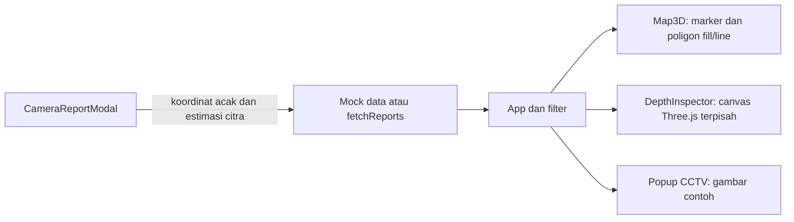

# Analisis Oyenza dan dampaknya pada LaporJalan

Dokumen ini memisahkan fakta dari bundle publik, fakta kode lokal, dan rancangan yang belum diuji. Acuan: 16 Oktober 2026, Asia/Jakarta. ID sumber merujuk [sources.json](sources.json).

## Kesimpulan

Kota 3D Oyenza terbentuk dari vector tiles, ekstrusi footprint bangunan, styling berdasarkan zoom, dan kamera MapLibre. Cekungan jalan pada referensi video merupakan kebutuhan tambahan LaporJalan. Memperbesar pitch kamera atau menggambar poligon gelap tidak menghasilkan permukaan jalan yang terdeformasi.

Prioritas implementasi: konsistensi kamera dan ukuran, prototipe satu cekungan dalam peta, lalu integrasi serta penyempurnaan kota/UI. [ADR-001](ADR-001.md) menetapkan batas pendekatan ini.

## Metode dan batas penelitian

- Membaca dokumen proyek, komponen peta, inspector, data, API frontend, serta kontrak backend terkait.
- Memeriksa gambar pembanding dan laporan pemeriksaan video terdahulu. Audio/video tidak ditranskripsi ulang dalam penyusunan paket.
- Mengambil HTML, JavaScript, dan CSS yang memang dirujuk situs publik melalui HTTP biasa. Endpoint utama dan compare memberi status 200; alat web sebelumnya gagal mengambilnya. Perbedaan akses dicatat, bukan dianggap bukti perubahan arsitektur.
- Menelusuri contoh resmi GitHub MapLibre versi 4.7.1 dan pembanding Mini Tokyo 3D. Pencarian repositori `oyenza` serta domain dalam README menghasilkan 0 pada tanggal pemeriksaan. Ini bukan bukti bahwa kode sumber tidak tersedia di tempat lain.
- Tidak mengakses akun, endpoint privat, source map yang ditebak, atau menyalin seluruh aset pihak ketiga ke aplikasi. Hash dan penunjuk bukti disimpan agar pembacaan dapat diulang.

## Mekanisme Oyenza yang terlihat dari kode publik

| Bukti | Temuan | Makna |
| --- | --- | --- |
| O2, banner lisensi dan versi | MapLibre GL JS 5.24.0 | Engine peta terverifikasi; bukan dugaan dari screenshot |
| O2, `jbd-base-v2` dan `jbd-bld-v2` | Tile dasar dan bangunan dilayani melalui jalur `/tiles/.../{z}/{x}/{y}.mvt` | Sumber bangunan terpisah dari geometri dekoratif manual |
| O2, `bld-3d` | `fill-extrusion`, source `bld`, source-layer `buildings`; tinggi `height`, dasar `min_height` | Footprint dan atribut sumber menentukan bentuk kota |
| O2, ekspresi tinggi | Zoom 14.5 bernilai 0; zoom 15.5 mencapai tinggi atribut, fallback 5 meter | Transisi bentuk bangunan ketika mendekat |
| O2, paint | Opacity 0.92; vertical gradient; warna berubah berdasarkan tinggi | Kedalaman visual juga bergantung pada styling dan pencahayaan |
| O2, palet calm | Bangunan `#E9E9EC` dan menara `#DCDCE1`; jalan dominan putih | Tersedia varian palet netral; jangan menyimpulkan semua rute situs memakai varian yang sama |
| O2, `set3D` | Pitch 56, bearing saat ini atau -17, zoom minimum 15.4, durasi 1000 ms atau 0 untuk reduced motion | Transisi kamera dan visibilitas layer bekerja bersama |
| O2, konstruktor map | maxPitch 65, maxZoom 18.6, pixel ratio dibatasi 2 | Batas render berbeda dari inspeksi LaporJalan pada pitch 74 |
| O2, layer buses | Custom layer bernama `buses`, rendering mode 2d | Objek bergerak memakai jalur render khusus; ini bukan bukti mesh bus 3D |
| O3 | Token warna, ukuran panel dasar 400 px, dan styling responsif | Nilai token bukan ukuran efektif semua viewport |
| O4 | Pengamatan bus CCTV dibandingkan perkiraan berbasis jadwal | Compare bukan slider kerusakan sebelum/sesudah |

Sumber langsung: [bundle peta](https://transit.oyenza.com/assets/lib-GZTYGNAT.js), [CSS](https://transit.oyenza.com/assets/app-ZWGDPUS7.css), [compare](https://transit-staging.oyenza.com/compare).

Data bangunan Oyenza tidak identik dengan OpenFreeMap. Gaya Positron yang diperiksa memakai source `openmaptiles`, source-layer `building`; pemetaan atribut perlu mengikuti schema sumber tersebut. Jangan memindahkan nama `buildings`, `height`, atau endpoint Oyenza ke LaporJalan tanpa verifikasi. Gunakan sumber yang memang tersedia dan pertahankan atribusinya.

Tidak ada bukti pada modul yang diperiksa bahwa Oyenza memotong permukaan jalan menjadi lubang. Tidak ada kesimpulan tentang keseluruhan backend, asal pengukuran tinggi bangunan, atau semua modul situs yang tidak ditelusuri.

## Alur lokal dan gap kritis

Nomor baris adalah lokasi pada baseline penyusunan. Cari simbol kembali sebelum mengedit.

| Prioritas | Fakta kode | Dampak dan arah perbaikan |
| --- | --- | --- |
| P1 | `Map3D.tsx:458` memakai layer fill/line; `DepthInspector3D.tsx:72` membuat plane pada canvas tersendiri | Pindahkan jalur inspeksi utama ke custom layer peta; gunakan kembali perhitungan profil setelah diperbaiki |
| P1 | `Map3D.tsx:723,787` menetapkan pitch 58 untuk laporan/pencarian | Semua intent kamera harus membaca mode yang sama; auto-tilt tidak boleh mengalahkan 2D |
| P1 | `Map3D.tsx:91` radius 4 m; galian pada baris 186 memakai panjang 9.5 m dan lebar 3.4 m | Pisahkan marker terbaca dari geometri yang mengikuti data; jangan menyatakan ukuran sintetis sebagai ukuran laporan |
| P1 | `DepthInspector3D.tsx:76` memaksa depth minimum 0.04 m, radius minimum 0.18 m, dan fallback saat nilai falsy | Laporan dangkal berubah bentuk; nol/hilang/invalid harus ditangani eksplisit |
| P1 | `CameraReportModal.tsx:86` membuat latitude/longitude dengan Math.random | Bentuk yang tertambat pada koordinat belum tentu berada di jalan yang benar; identifikasi sebagai data contoh sampai sumber posisi diperbaiki |
| P1 | `imageDetection.ts` menghitung dimensi dan confidence dengan heuristik citra; UI masih memuat klaim akurasi | Konsistensi skala tidak sama dengan metrologi; label estimasi dan jangan klaim pengukuran tervalidasi |
| P2 | Map load/click handler didaftarkan sekali dan menangkap `reports` awal; update source keluar saat style belum siap | Data baru atau data yang datang sebelum load perlu diuji, termasuk klik poligon setelah fetch |
| P2 | `selectedReport` dapat tetap terpilih meskipun daftar tersaring | Hilangkan geometri/inspeksi yang tidak termasuk filter; jangan menampilkan objek tersembunyi diam-diam |
| P2 | Bangunan dari `BUILDINGS_3D_GEOJSON`; lebar jalan 7 m hardcoded | Gunakan footprint sumber peta; lebar jalan tidak tersedia harus dinyatakan demikian |
| P2 | `CctvPopover` merender img, status LIVE, pengelola tetap, dan callback fullscreen tidak disuplai | Kontrak media/status harus mengikuti sumber; siapkan aksi fullscreen dan cleanup sesuai jenis media |
| P2 | Inspector memakai Gaussian terpotong, variasi mikro, serta lingkaran kontur analitis | Kontur tidak otomatis mengikuti permukaan aktual, terutama galian; satu sampler harus menjadi sumber seluruh geometri |

Rujukan lokal: [Map3D](../../src/components/Map3D.tsx), [inspector](../../src/components/DepthInspector3D.tsx), [App](../../src/App.tsx), [pelaporan](../../src/components/CameraReportModal.tsx), [deteksi](../../src/services/imageDetection.ts), [CCTV](../../src/components/CctvPopover.tsx), [types](../../src/types.ts), dan [API](../../src/services/api.ts).

## Masalah teknis yang harus dibuktikan

1. **Depth buffer dan permukaan dasar.** Mesh yang turun ke bawah nol dapat tertutup jalan atau tanah. Berhasil merender objek di atas peta tidak membuktikan bahwa cekungan dapat terlihat. P2 harus menyimpan hasil dari beberapa sudut dengan bangunan penghalang.
2. **Koordinat dan satuan.** Bangun mesh dalam meter lokal; konversikan anchor dengan MercatorCoordinate dan skala meter pada latitude anchor. Jangan menganggap satu unit Mercator sebagai satu meter. Periksa orientasi sumbu dan winding triangle.
3. **Skala yang dapat dilihat.** Lubang 0.52 m memang kecil pada zoom kota. Perbesar hit target/penanda atau dekatkan kamera; geometri 1:1 tidak boleh membesar diam-diam. Mode ilustrasi harus menyebut faktor pembesaran.
4. **Shared context.** Integrasi menggunakan canvas dan GL MapLibre. Cleanup inspector lama yang memanggil forceContextLoss hanya berlaku pada konteks tersendiri dan tidak boleh disalin ke custom layer.
5. **Versi.** Signature render lokal 4.7.1 menerima `(gl, matrix, options)`; contoh terbaru dapat berbeda. Three 0.170.0 memerlukan WebGL2, sementara MapLibre dapat fallback ke WebGL1. Periksa konteks sebelum membuat renderer.

Dasar integrasi: [contoh GitHub 4.7.1](https://github.com/maplibre/maplibre-gl-js/blob/v4.7.1/test/examples/add-3d-model.html) dan [CustomLayerInterface](https://maplibre.org/maplibre-gl-js/docs/API/interfaces/CustomLayerInterface/). Contoh versi 4.7.1 sendiri memakai Three yang lebih lama; gunakan sebagai pola integrasi, bukan bukti kompatibilitas otomatis dengan seluruh kombinasi versi lokal.

## Koreksi terhadap catatan lama

| Klaim histori | Koreksi 16 Oktober 2026 |
| --- | --- |
| Opacity Oyenza 0.75-0.85 dan atribut render_height | Bundle yang diperiksa memakai 0.92 serta height/min_height. Atribut bergantung sumber tile. |
| Ln dan Vr membentuk frustum CCTV | Nama minified berulang di scope berbeda. Pada factory transit map, Ln menangani lokasi pengguna dan Vr visibilitas bangunan; versi internal library berkaitan matematika kamera. Nama saja tidak membuktikan fungsi CCTV. |
| Cuplikan cekungan membuktikan kemampuan Oyenza | Cuplikan bertanda gemini_generated_video adalah referensi ilustratif. |
| Fase 13/14 selesai berarti sudah setara visual | Laporan video kemudian menunjukkan gap inspeksi. Checkbox historis tidak menggantikan uji penerimaan baru. |
| TypeScript lulus atau screenshot membuktikan 60 FPS/zero leak | Pemeriksaan tersebut tidak mengukur frame time atau kestabilan resource. |
| Lebar jalan 7 m adalah metrik lokasi | Nilai UI hardcoded, belum bersumber pengukuran. |

Riwayat tetap disimpan. Koreksi ini membatasi klaim pada bukti yang tersedia; tidak mengubah fitur aplikasi pada sesi dokumentasi.

## Dampak dan prioritas

P1-P3 menyentuh state kamera, adapter dimensi, lifecycle map, dan inspector. P4 menyentuh style bangunan dan tata letak. P5 menyentuh label data/media dan kontrol CCTV. API backend serta schema penyimpanan dipertahankan pada pendekatan awal. Bila sumber ukuran/posisi nyata memerlukan kontrak baru, planner harus memberikan tiga pilihan melalui /grillme sebelum memperluas lingkup.

Penampil lama boleh tetap tersedia sebagai pembanding selama migrasi. Jangan menghapus jalur yang masih dipakai sebelum custom layer lolos. Tidak perlu menambah physics engine, kendaraan, raycast suspension, terrain kota, atau framework orkestrasi baru untuk membuktikan satu cekungan.
