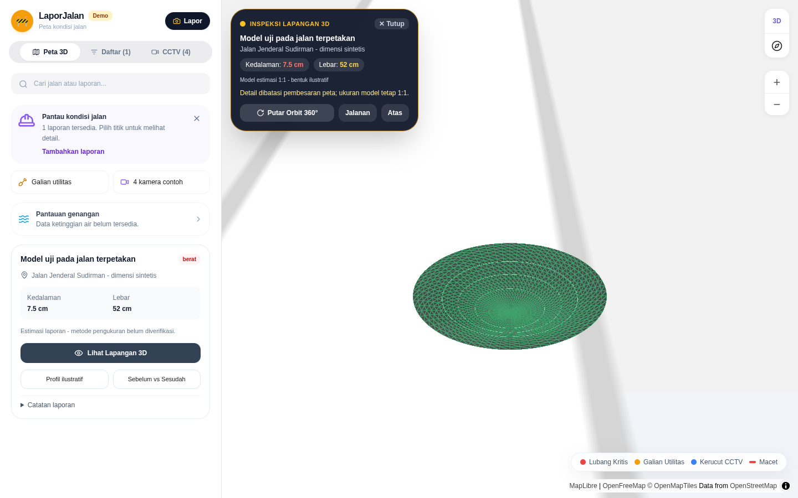
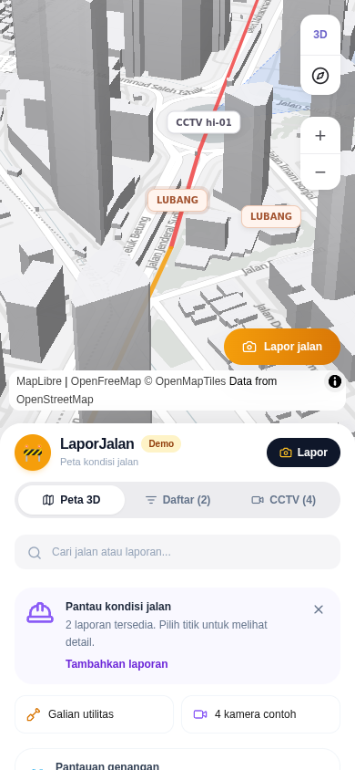

# Cycle22 visual evidence

These are actual cycle22 browser captures, linked without pixel edits. They are review evidence, not replacements for any baseline. The candidate passed the existing82 functional cases and the close-inspection review. Whole-city MSAA is disabled: building edges are visibly more jagged than cycle20. The paired benchmark is still being evaluated, and full acceptance is incomplete.

Use [the review](harness/CYCLE22-REVIEW.md), [current handoff](HANDOFF.md) and [remaining acceptance](REMAINING-ACCEPTANCE.md) for scope. [Earlier previews](PREVIEW.md) remain historical cycle20 evidence.

## City desktop

## Inspection desktop

## City mobile

## Inspection mobile

