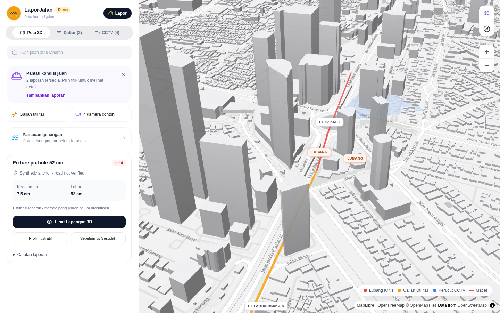
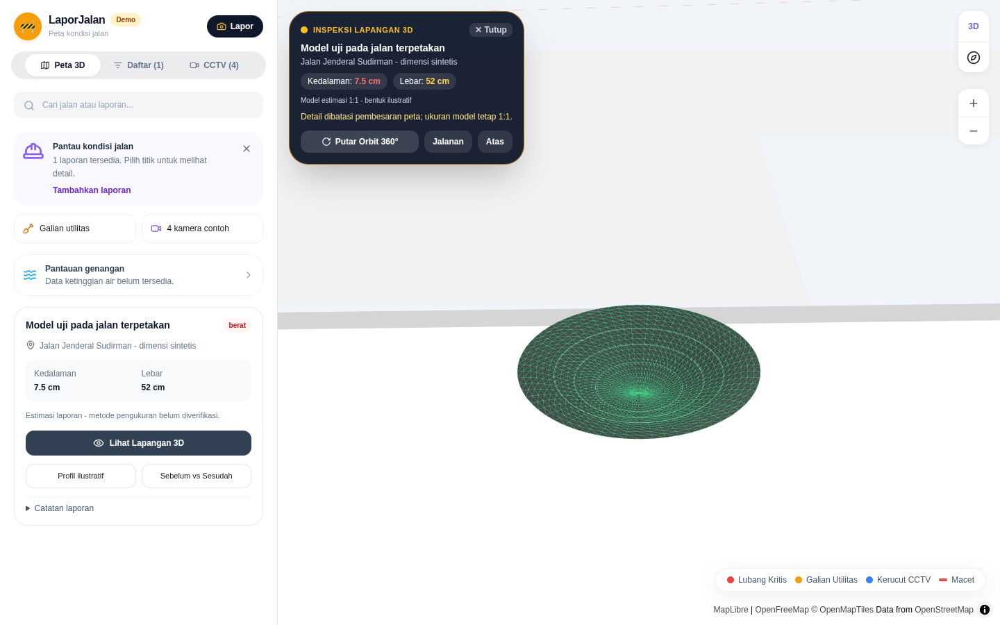
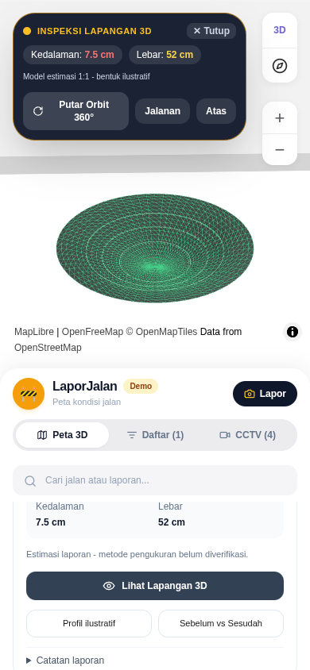
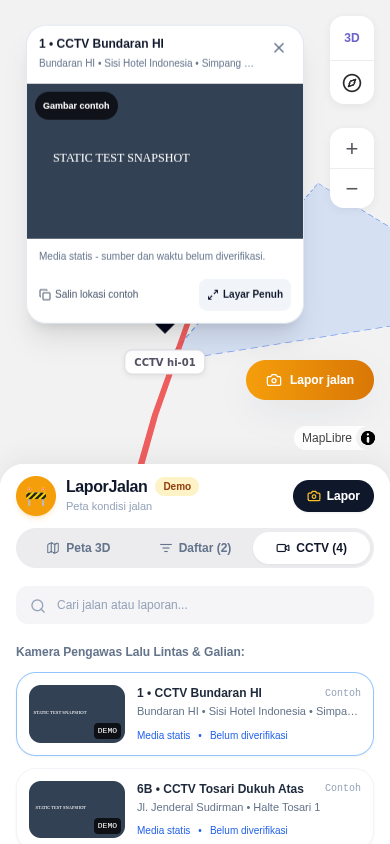

# Current visual evidence

These images are unedited copies from cycle20-full, which passed82functional checks. Independent review separately inspected the matching mapped-road/app states. Reports and CCTV media in the test are synthetic; the road anchor is mapped OSM data. No live camera feed or measured road damage is claimed. Performance validation remains pending after the runner's first attempt failed to collect sufficient samples.

## City

## Inspection

## CCTV

Original paths and SHA256 hashes are in preview/sources.json. See FINAL-INDEPENDENT-REVIEW.md for the review scope and HANDOFF.md for remaining work.
